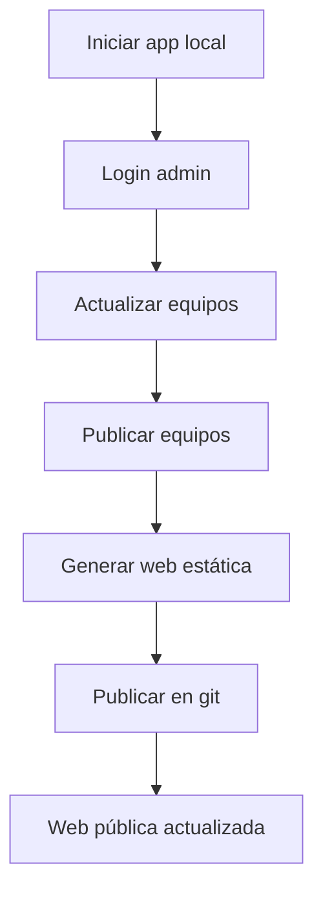

# Instrucciones de uso

## Inicio

1. Instala Node.js 18 o superior.
2. Ejecuta `npm install`.
3. Copia `.env.example` a `.env`.
4. Configura `ADMIN_PASS` y `GIT_REPO`.
5. Ejecuta `npm start`.
6. Abre http://localhost:3000.

## Administración

1. Escribe la contraseña de administrador.
2. Pulsa "Entrar".
3. Escribe el Series ID del grupo.
4. Pulsa "Actualizar" para escanear equipos.
5. Revisa el resumen y los equipos pendientes.
5. Pulsa "Publicar" en cada equipo válido.
6. Pulsa "Recolocar" entre temporadas.
7. Pulsa "Generar web estática".
8. Pulsa "Publicar en git" y confirma.

## Web pública

La carpeta `public/` contiene los archivos estáticos.
Sube esa carpeta al servidor o repositorio.

## Diagrama de flujo

